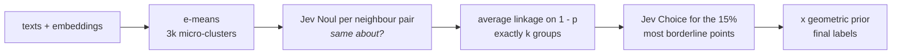
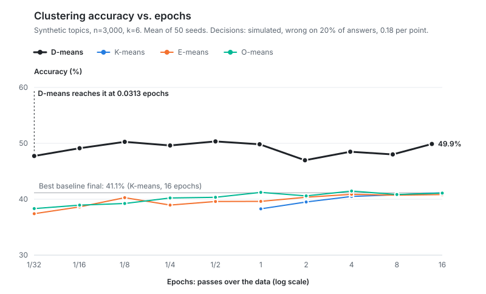
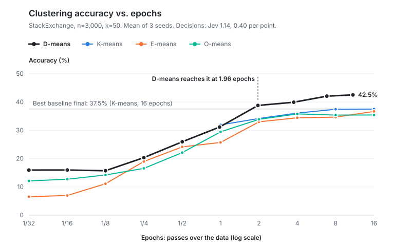

<h1 align="center">
  <picture>
    <source media="(prefers-color-scheme: dark)" srcset="assets/d-means-banner-dark.png">
    
  </picture>
</h1>

<p align="center">
  <b>k-means that asks before it guesses.</b><br>
  Geometry decides <i>how far</i>. A typed decision model decides <i>what kind</i>.
</p>

<p align="center">
  
  
  
  
</p>

---

k-means, [e-means](https://arxiv.org/abs/2611.09501) and [o-means](https://github.com/owlgebra-ai/faiss/tree/main/contrib/o_means) all cut embedding space by distance alone. e-means and o-means make that cut **faster**. None of them can make it **right** when distance is wrong: two categories that sit close together get merged, one category that is spread out gets split, and points between two centroids are a coin flip.

**d-means** keeps the fast geometry (it runs on e-means) and hands the two decisions geometry cannot make to [Jev](https://docs.typesafe.ai), TypeSafe's System One decision model, which reads the texts and answers typed questions with calibrated probabilities.

<!-- bench:semantic -->
| Dataset | n | k | k-means | e-means | o-means | **d-means** | vs best | Jev cost / run |
|:--|--:|--:|--:|--:|--:|--:|--:|--:|
| TREC | 500 | 6 | 55.6 | 58.1 | 58.1 | **65.9** | +7.8 | $0.004 |
| StackExchange | 3,000 | 50 | 37.6 | 33.7 | 34.8 | **42.3** | +4.7 | $0.033 |

Clustering accuracy (%), mean of seeds 0, 1, 2. *vs best* is d-means minus the best baseline. d-means beats the best baseline on ACC, NMI and ARI on 2 of 2 datasets (TREC and StackExchange on every seed). Every d-means number comes from real Jev 1.14 answers through OpenRouter (8,866 decisions, committed in [`bench/results/jev-answers.jsonl.gz`](bench/results/jev-answers.jsonl.gz)).

<details><summary>NMI and ARI</summary>

| Dataset | k-means NMI | e-means NMI | o-means NMI | d-means NMI | k-means ARI | e-means ARI | o-means ARI | d-means ARI |
|:--|--:|--:|--:|--:|--:|--:|--:|--:|
| TREC | 41.3 | 45.7 | 45.7 | **48.6** | 38.0 | 42.2 | 42.2 | **46.1** |
| StackExchange | 48.1 | 46.0 | 46.8 | **52.3** | 23.1 | 18.6 | 20.7 | **28.9** |

</details>
<!-- /bench:semantic -->

## How it works



1. **Over-cluster.** e-means splits the data into `3k` micro-clusters. They are much purer than `k` clusters.
2. **Merge by decision.** Each micro-cluster becomes a card: its most distinctive words (class-based TF-IDF) and the four texts nearest its centroid. For every micro-cluster and its six nearest neighbours, Jev answers one Noul: *do these two groups share the same `about`?* Pairs it was not asked get an isotonic prior fitted on the pairs it was asked. Average linkage on `1 - p` joins the micro-clusters into exactly `k` groups.
3. **Settle the borderline.** The 15% of points with the smallest margin between their two nearest groups get one Choice over their five nearest groups. Jev's probabilities are multiplied by the geometric posterior and the point takes the argmax.

Decisions cost about 0.3 to 0.4 per point. At the measured $0.0000265 per decision, a TREC run costs $0.004 and a StackExchange run $0.033.

## Quick start

```bash
uv sync
export OPENROUTER_API_KEY=sk-or-...
```

```python
from dmeans import DMeans, Jev

model = DMeans(k=6, decider=Jev(cache="answers.jsonl.gz"),
               about="type of answer the question asks for")
labels = model.fit(embeddings, texts)   # embeddings: (n, d) float32, texts: n strings
print(model.report)                     # decisions asked, points moved
```

The e-means and o-means engines work on their own, on any vectors:

```python
from dmeans import EMeans, OMeans

centroids, labels = EMeans(k=1024, nepochs=5).fit(x)
centroids, labels = OMeans(k=8192, nepochs=2).fit(x)   # two-level assignment
```

### Bring your own decision model

Jev is the default, not a requirement. `decider` takes any of three things:

```python
from dmeans import DMeans, Jev, LLM

DMeans(k, decider=Jev())                                      # TypeSafe Jev, Decisions API
DMeans(k, decider=LLM("openai/gpt-5-mini"))                   # any chat model on OpenRouter
DMeans(k, decider=LLM("qwen3:8b", base_url="http://localhost:11434/v1", api_key_env=None))  # local Ollama
DMeans(k, decider=lambda state, question: ...)                # your own function
```

`LLM` speaks any OpenAI-compatible `/chat/completions` endpoint, caches and replays answers offline exactly like `Jev`, and re-asks when a reply is unusable. A function gets one typed question at a time and may answer loosely: `True`, `"87%"`, an option name, or unnormalised scores. Every answer is checked and coerced into one shape before d-means uses it, and a missing answer fails with the question it skipped. Anything else with `ask(requests) -> answers` works too; subclass `CachedDecider` to get the cache for free.

The benchmark numbers above are Jev's. Other models are untested on them.

## Benchmark

```bash
uv run python -m bench.semantic --verify   # offline replay of the committed Jev answers
uv run python -m bench.semantic --live     # ask Jev again (needs OpenRouter credits)
uv run python -m bench.mse --write         # engine benchmark, no decision model
uv run python -m bench.convergence --verify # accuracy vs epochs, offline, about 25 s
uv run pytest                              # 33 offline tests, about 10 s
```

Datasets: [TREC](https://huggingface.co/datasets/SetFit/TREC-QC) questions by answer type and [StackExchange](https://huggingface.co/datasets/mteb/stackexchange-clustering) titles by site (3,000 from the first MTEB validation split). [AG News](https://github.com/mhjabreel/CharCnn_Keras/tree/master/data/ag_news_csv) headlines by section, [BBC News](https://huggingface.co/datasets/SetFit/bbc-news) articles by topic, [20 Newsgroups](https://huggingface.co/datasets/SetFit/20_newsgroups) posts by group and [Banking77](https://github.com/PolyAI-LDN/task-specific-datasets) customer requests by intent are pinned and wait for a live run. Test splits, texts cut at 1,000 characters. Embeddings: `sentence-transformers/all-mpnet-base-v2`. Baselines: scikit-learn `KMeans` (k-means++, Lloyd to convergence), e-means and o-means at 5 epochs, all on the same embeddings and seeds.

**Ablations.** Every variant tried is listed. Defaults were fixed before the first run and none was tuned on these datasets.

<!-- bench:ablation -->
| Variant | TREC | StackExchange | decisions / point |
|:--|--:|--:|--:|
| best baseline | 58.1 | 37.6 | 0 |
| geometric merge (no decisions) | 59.5 | 35.9 | 0 |
| **d-means (default)** | 65.9 | 42.3 | 0.30 to 0.41 |
| merge only (no point decisions) | 62.3 | 38.9 | 0.15 to 0.26 |
| point budget 5% | 63.9 | 40.0 | 0.20 to 0.31 |
| point budget 10% | 64.9 | 41.2 | 0.25 to 0.36 |
| decision only (no geometric prior) | 66.0 | 42.4 | 0.30 to 0.41 |
| 10 merge neighbours | 65.3 | 42.5 | 0.38 to 0.59 |
| spectral merge | 61.7 | 41.5 | 0.30 to 0.41 |

ACC (%), mean of the same seeds.
<!-- /bench:ablation -->

<!-- bench:diagnose -->

<!-- /bench:diagnose -->

The same micro-clusters merged by geometry alone gain little. The decisions carry the gain, and each stage adds to it.

**Convergence.** How many passes over the data each method needs before its clusters match the real categories. Every point is a finished run with that epoch budget. The first chart is synthetic and runs offline: 6 topics, each spread over 4 sub-topic modes placed at random, so neighbouring modes often belong to different topics, with a simulated decider that reads the hidden topic and answers wrong one time in five. The TREC and StackExchange charts are real texts with real Jev answers (40,298 decisions, about $1, committed in [`bench/results/jev-convergence.jsonl.gz`](bench/results/jev-convergence.jsonl.gz)). Where o-means draws over e-means, it scans every cell at that k.

<!-- bench:convergence -->
<picture>
  <source media="(prefers-color-scheme: dark)" srcset="assets/convergence-topics-dark.svg">
  
</picture>

| Method | ACC at 1/32 epoch | ACC at 1 epoch | ACC at 16 epochs | Epochs to reach 41.1% |
|:--|--:|--:|--:|--:|
| k-means | - | 38.3 | 41.1 | 16 |
| e-means | 38.1 | 40.1 | 40.5 | 3.93 |
| o-means | 38.1 | 40.1 | 40.5 | 3.93 |
| **d-means** | **48.0** | **49.8** | **49.9** | **0.0213** |

Synthetic topics, mean of 50 seeds, decisions from a simulated decider, wrong on 20% of answers. The best baseline ends at 41.1% (k-means, 16 epochs). d-means passes it at its first budget, 0.0213 epochs, 184x sooner than the fastest baseline gets there (e-means, 3.93 epochs).

<picture>
  <source media="(prefers-color-scheme: dark)" srcset="assets/convergence-trec-dark.svg">
  
</picture>

| Method | ACC at 1/32 epoch | ACC at 1 epoch | ACC at 16 epochs | Epochs to reach 55.6% |
|:--|--:|--:|--:|--:|
| k-means | - | 51.3 | 55.6 | 16 |
| e-means | 43.4 | **57.2** | 54.9 | **0.496** |
| o-means | 43.4 | **57.2** | 54.9 | **0.496** |
| **d-means** | **49.5** | 56.9 | **64.3** | 0.512 |

TREC, mean of 3 seeds, decisions from Jev 1.14. The best baseline ends at 55.6% (k-means, 16 epochs). d-means reaches it at 0.512 epochs; e-means gets there first, at 0.496 epochs.

<picture>
  <source media="(prefers-color-scheme: dark)" srcset="assets/convergence-stackexchange-dark.svg">
  
</picture>

| Method | ACC at 1/32 epoch | ACC at 1 epoch | ACC at 16 epochs | Epochs to reach 37.5% |
|:--|--:|--:|--:|--:|
| k-means | - | **31.9** | 37.5 | 16 |
| e-means | 15.2 | 26.5 | 35.4 | never |
| o-means | 15.1 | 27.6 | 36.6 | never |
| **d-means** | **22.6** | 31.2 | **42.5** | **1.96** |

StackExchange, mean of 3 seeds, decisions from Jev 1.14. The best baseline ends at 37.5% (k-means, 16 epochs). d-means passes it at 1.96 epochs, 8x sooner than the fastest baseline gets there (k-means, 16 epochs).
<!-- /bench:convergence -->

Geometry converges, but to the wrong partition, and more epochs do not fix it. On the synthetic topics d-means is past the best baseline after one mini-batch. On real texts the picture is mixed: on StackExchange (k=50) d-means passes the best baseline at 2 epochs while e-means and o-means never get there, but on TREC (k=6) e-means touches the target first, at half an epoch, and then falls back below it. d-means keeps climbing on both and ends 8.7 points (TREC) and 5.0 points (StackExchange) above the best baseline. `bench.convergence --problems trec,stackexchange --seeds 0,1,2 --verify` replays the real curves offline.

**Engines.** The e-means and o-means reimplementations reproduce what their authors report: e-means passes Lloyd's 25-iteration error within a few epochs, and o-means reaches it with a fraction of the distance computations.

<!-- bench:mse -->
| Problem | Epochs | e-means MSE vs Lloyd@25 | o-means MSE vs Lloyd@25 | o-means distances vs e-means | Lloyd@25 time | e-means time | o-means time |
|:--|--:|--:|--:|--:|--:|--:|--:|
| synthetic (n=100k, d=32, k=8192) | 1 | +4.93% | +4.94% | 0.26x | 111.2s | 3.1s | 1.2s |
| synthetic (n=100k, d=32, k=8192) | 2 | -0.96% | -0.47% | 0.26x | 111.2s | 4.3s | 3.0s |
| synthetic (n=100k, d=32, k=8192) | 3 | -1.56% | -1.00% | 0.26x | 111.2s | 5.6s | 4.8s |
| synthetic (n=100k, d=32, k=8192) | 5 | -2.52% | -1.97% | 0.26x | 111.2s | 14.8s | 4.9s |
| text embeddings (n=20k, d=768, k=512) | 1 | +2.28% | +1.30% | 0.75x | 7.4s | 0.4s | 0.9s |
| text embeddings (n=20k, d=768, k=512) | 2 | -0.32% | -0.19% | 0.77x | 7.4s | 0.7s | 1.0s |
| text embeddings (n=20k, d=768, k=512) | 3 | -0.59% | -0.91% | 0.79x | 7.4s | 0.9s | 1.2s |
| text embeddings (n=20k, d=768, k=512) | 5 | -1.06% | -0.98% | 0.80x | 7.4s | 1.4s | 1.1s |
<!-- /bench:mse -->

Held-out MSE, seed 1. Wall times come from a shared, heavily loaded 18-core M5 Max, so read them as rough.

## Fine print

- d-means takes one input the baselines cannot: `about`, a few words that name the grouping ("news topic", "customer request"). Distance has no way to know you mean answer type rather than subject. No label names go in.
- It needs something Jev can read for each point. On bare vectors use `EMeans` or `OMeans`.
- It optimizes agreement with human categories, not squared error. Its engine is e-means, so it keeps e-means' speed.
- Measured on two datasets so far. The other four load from pinned files in `bench/data.py`; their live run (`--live --write --datasets trec,stackexchange,ag-news,bbc-news,20-newsgroups,banking77`) asks about 31,000 new Jev decisions, an estimated $1 to $2.
- Replay rebuilds the exact requests, so it needs the embeddings in `.cache/emb`. A fresh clone re-embeds through OpenRouter on the first run.

## Background: e-means and o-means

- **e-means** (Bessa et al., Meta FAIR, [arXiv:2611.09501](https://arxiv.org/abs/2611.09501)): mini-batch k-means with exponential-moving-average centroids, a cosine step schedule, scaling laws that set batch size and step from `(n, k, T)`, dead-cluster revival by splitting a donor, and a last-pass mean. It beats Lloyd's 25-epoch loss in 1.4 to 2.6 epochs, 10 to 45x faster on GPU. Section 3.4 adds approximate (IVF) assignment, where each point is compared only with nearby centroids: 4.3x cheaper at 1B points and 34x at 10B.
- **o-means** ([faiss contrib](https://github.com/owlgebra-ai/faiss/tree/main/contrib/o_means)): e-means with a two-level assignment. Centroids are grouped into cells and each row scans only its `nprobe` nearest cells. The idea is the IVF assignment of e-means Section 3.4, so credit for it belongs to the e-means paper. o-means reports reaching e-means' error 4.49x faster (geometric mean, one RTX 5090).

Both are faster solvers for the same objective. d-means changes what gets decided.

## License

MIT. Dependencies are NumPy, SciPy and scikit-learn (BSD). e-means and o-means are reimplemented here from their public descriptions.
