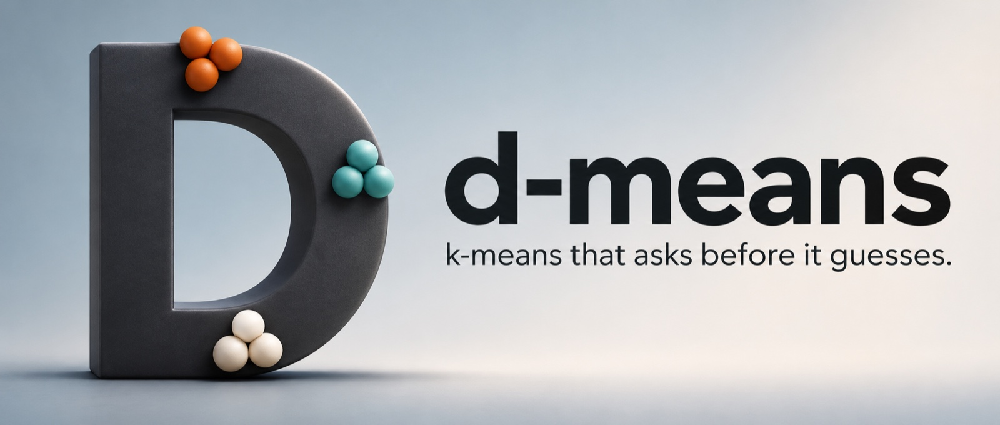
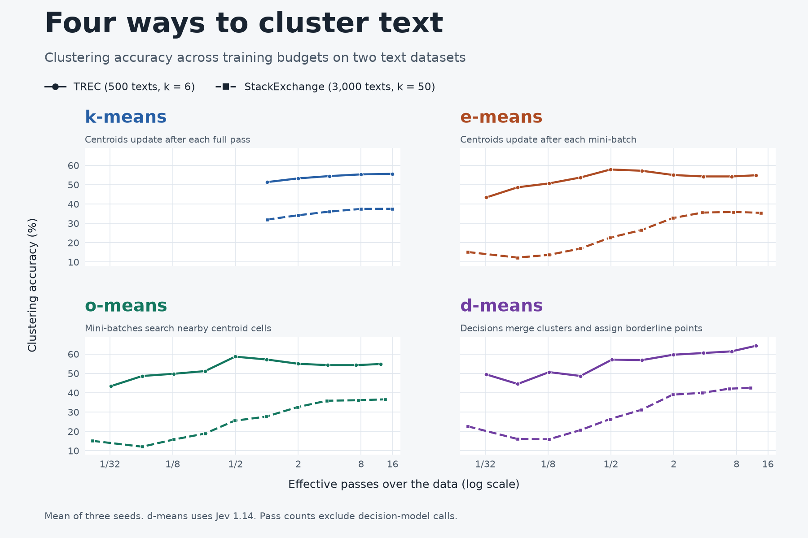
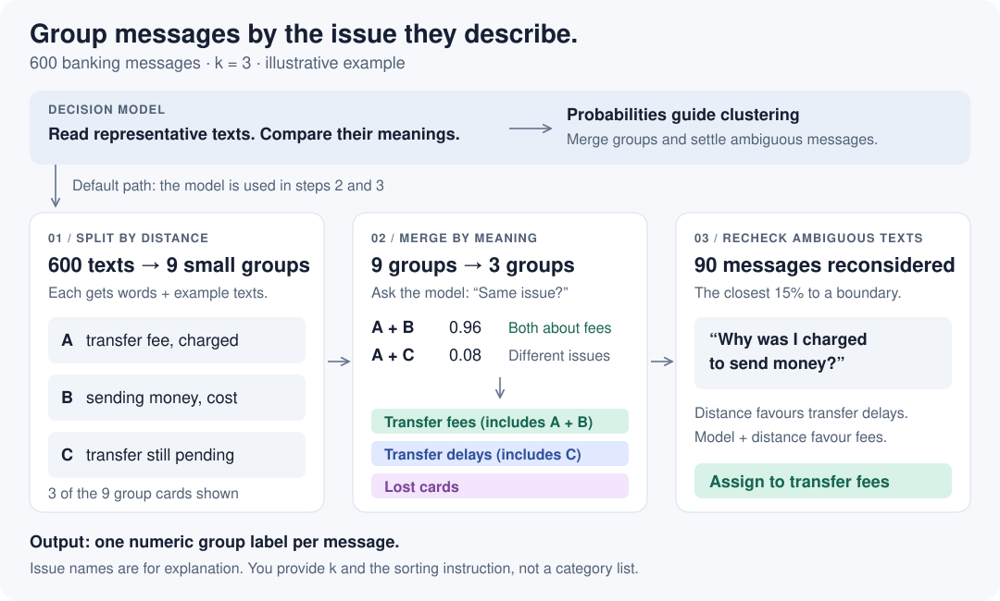

<h1 align="center">
  
</h1>

<p align="center">
  Python 3.10+ · <a href="LICENSE">MIT License</a> ·
  <a href="#quick-start">Quick start</a> ·
  <a href="#how-it-works">How it works</a> ·
  <a href="#benchmark">Benchmark</a> ·
  <a href="#decision-models">Decision models</a>
</p>

[e-means](https://arxiv.org/abs/2611.09501) and [o-means](https://github.com/owlgebra-ai/faiss/tree/main/contrib/o_means) make k-means **faster**, not **right**. **d-means** combines embedding–lexical consensus with a decision model to settle hard boundaries.

### Semantic clustering benchmark

<!-- bench:consensus -->
| Dataset | k&#8209;means | e&#8209;means | o&#8209;means | **d&#8209;means** |
|:--|--:|--:|--:|--:|
| TREC | 55.6 | 58.1 | 58.1 | **66.8** |
| StackExchange | 37.6 | 33.7 | 34.8 | **42.4** |
| AG News | 83.7 | 83.5 | 83.5 | **84.1** |
| BBC News | 86.5 | 86.9 | 86.9 | **95.6** |
| 20 Newsgroups | 56.9 | 49.3 | 52.4 | **57.2** |
| Banking77 | 61.1 | 58.9 | 59.4 | **63.5** |

Clustering accuracy (%), mean of seeds 0, 1, 2. d-means uses embedding–lexical consensus where the views agree and Clef otherwise. d-means beats the best baseline on ACC, NMI and ARI on 6 of 6 datasets. ACC leads on every seed for TREC, StackExchange, AG News and Banking77.

<details><summary>Run details, NMI and ARI</summary>

| Dataset | Texts | Clusters | Lead (pp) | Cost/run |
|:--|--:|--:|--:|--:|
| TREC | 500 | 6 | +8.7 | $0.014 |
| StackExchange | 3,000 | 50 | +4.8 | $0.115 |
| AG News | 7,600 | 4 | +0.3 | $0 |
| BBC News | 1,000 | 5 | +8.7 | $0 |
| 20 Newsgroups | 7,299 | 20 | +0.3 | $0 |
| Banking77 | 3,080 | 77 | +2.4 | $0.123 |

Lead is the accuracy difference from the best baseline, in percentage points.

| Dataset | k-means NMI | e-means NMI | o-means NMI | d-means NMI | k-means ARI | e-means ARI | o-means ARI | d-means ARI |
|:--|--:|--:|--:|--:|--:|--:|--:|--:|
| TREC | 41.3 | 45.7 | 45.7 | **50.5** | 38.0 | 42.2 | 42.2 | **47.3** |
| StackExchange | 48.1 | 46.0 | 46.8 | **52.1** | 23.1 | 18.6 | 20.7 | **28.9** |
| AG News | 59.9 | 60.1 | 60.1 | **61.3** | 62.8 | 62.4 | 62.4 | **63.5** |
| BBC News | 80.9 | 82.0 | 82.0 | **86.7** | 79.2 | 80.2 | 80.2 | **89.5** |
| 20 Newsgroups | 56.9 | 55.4 | 56.1 | **58.1** | 40.1 | 38.4 | 39.4 | **41.7** |
| Banking77 | 80.3 | 80.5 | 80.6 | **85.2** | 51.2 | 50.3 | 50.7 | **56.5** |

</details>
<!-- /bench:consensus -->

We developed the consensus strategy on these six datasets. The comparison uses the original baseline settings, including one initialization for k-means and eight for each embedding-based consensus fit. The results measure performance on the development benchmarks. [See the per-seed results](bench/results/semantic-consensus-clef.json).

<p align="center">
  
</p>

The TREC and StackExchange convergence plot uses Jev 1.14 with consensus disabled. Each marker is the mean of three runs, and pass counts exclude Jev calls. See the [convergence analysis](#benchmark) for the replay commands and per-dataset curves.

## How it works

d-means takes **texts, their embedding vectors, and a target number of groups `k`**. The `about` instruction tells the decision model what makes two texts belong together, such as the customer's banking issue.

By default, it first groups the corpus in two ways: by embedding similarity and by the words the texts use. If those groupings agree enough, it combines the two representations and returns `k` groups **without calling the decision model**. If they disagree, or the word-based check cannot run, it takes the three steps below. Set `consensus=False` to always take this path.

<p align="center">
  
</p>

### Example: sort 600 banking messages into 3 groups

Suppose the messages cover transfer fees, delayed transfers, and lost cards. Two messages can both mention a *transfer* but describe different issues. Two others can describe the same fee using different words. Distance alone can mix them up.

For this walkthrough, force the decision path:

```python
from dmeans import DMeans
from dmeans.deciders import Decisions

model = DMeans(k=3, decider=Decisions("cloudflare/clef"),
               about="customer's banking issue", consensus=False)
labels = model.fit(embeddings, texts)  # 600 vectors and their 600 messages
```

The groups, probabilities, and scores below are illustrative, not benchmark outputs. The algorithm returns numeric labels; names such as "transfer fees" explain the example, and are not supplied as a predefined list of categories.

**1. Start with small groups.** e-means first makes `3 × k = 9` micro-clusters: small groups of nearby vectors. This gives the next step smaller pieces to merge. Each group gets a **card** containing distinctive words and up to four representative messages. Three of the nine cards might look like this:

| Card | Typical words | Example message |
|:--|:--|:--|
| A | transfer, fee, charged | "Why was I charged a transfer fee?" |
| B | sending, money, cost | "Does sending money cost extra?" |
| C | transfer, pending, arrived | "My transfer still hasn't arrived." |

**2. Ask which groups belong together.** For each small group and its six nearest neighbours, the model reads the two cards and answers: *Do these describe the same customer's banking issue?* This yes/no probability question is called a **Noul** in the API.

| Pair | Example probability of the same issue | Effect on merging |
|:--|--:|:--|
| A + B | 0.96 | Strong evidence to group the two fee clusters together |
| A + C | 0.08 | Strong evidence to keep fees and delays apart |

d-means uses all pair scores to merge the nine small groups into exactly three groups. It repeatedly joins the groups with the smallest average `1 − probability` between their members. The two rows above are evidence for that process, not independent yes/no merge rules.

**3. Reconsider the ambiguous messages.** After merging, each message starts in its nearest group. d-means selects the 15% whose distances to their two closest groups are most similar: **90 of these 600 messages**. For each, it asks the model to choose among the nearest groups, showing their cards. This multiple-option question is a **Choice** in the API.

For *"Why was I charged to send money?"*, suppose distance slightly favours transfer delays. d-means multiplies the model's probability by a distance-based weight:

| Candidate group | Model probability | Distance weight | Product |
|:--|--:|--:|--:|
| Transfer fees | 0.85 | 0.80 | **0.6800** |
| Transfer delays | 0.10 | 1.00 | 0.1000 |
| Lost cards | 0.05 | 0.05 | 0.0025 |

The largest product wins, so this message moves to **transfer fees**. The other 510 messages keep their assignments from the merge step. Both the model's reading and the vector distances influence the final choice.

<details><summary>Exact defaults and implementation details</summary>

- **Consensus check:** compare separate k-means partitions of unit-normalized embeddings and a low-rank TF-IDF representation using adjusted mutual information (AMI). A score of at least `1/3` triggers a fresh k-means fit on `[embedding, 0.3 × lexical]`. The check is skipped if there are too few usable lexical dimensions. `about` is used only on the decision path.
- **Small groups:** `over=3`; the initial count is `min(3k, max(k, n // 4))`, with empty groups dropped. Cards use class-based TF-IDF keywords and up to four texts nearest the group's mean vector.
- **Pair scoring:** `neighbors=6`, capped at the number of other micro-clusters, with duplicate pairs asked once. Unasked pairs get probabilities estimated from centroid cosine similarity, calibrated against the model's answers by isotonic regression. Average-linkage clustering on `1 − p` produces `k` groups.
- **Point selection:** `budget=0.15`; ask about `round(0.15 × n)` points with the smallest gap between their two nearest group distances. A group's distance is the minimum squared distance to one of its micro-cluster centroids.
- **Final choice:** `candidates=5`, capped at `k`. For each candidate, the distance weight is `exp(−(distance − closest_distance) / tau)`, where `tau` is the median gap across the corpus (or `1e-6` if zero). Multiply this by the model probability (with `1e-6` smoothing) and take the largest score. The example omits smoothing in the displayed arithmetic.

`model.partition_source` shows `"consensus"` or `"decision"`. `model.report` records pair decisions, point decisions, and points moved. Model calls depend on the path and settings; the consensus path uses zero.

</details>

## Quick start

```bash
uv sync
export OPENROUTER_API_KEY=sk-or-...
```

```python
from dmeans import DMeans
from dmeans.deciders import Decisions    # or LLM, or your own function

model = DMeans(k=6, decider=Decisions("cloudflare/clef", cache="answers.jsonl.gz"),
               about="type of answer the question asks for")
labels = model.fit(embeddings, texts)   # embeddings: (n, d) float32, texts: n strings
print(model.report)                     # decisions asked, points moved
```

The e-means and o-means engines work on their own, on any vectors:

```python
from dmeans import EMeans, OMeans

centroids, labels = EMeans(k=1024, nepochs=5).fit(x)
centroids, labels = OMeans(k=8192, nepochs=2).fit(x)   # two-level assignment
```

### Bring your own decision model

d-means is tied to no model, and no model is an import: you name it as a string. `decider` takes any of these:

```python
from dmeans import DMeans
from dmeans.deciders import Decisions, LLM

DMeans(k, decider=Decisions("typesafe/jev-1.14"))             # TypeSafe Jev, OpenRouter Decisions API
DMeans(k, decider=Decisions("cloudflare/clef"))               # Cloudflare Clef, open weights, same API
DMeans(k, decider=Decisions("google/gemini-decision-1"))      # Google Gemini Decision 1
DMeans(k, decider=Decisions("openai/gpt-6-luna-decisions"))    # OpenAI GPT-6 Luna Decisions
DMeans(k, decider=Decisions("liquid/d1.2-ultra"))              # Liquid AI d1.2-ultra
DMeans(k, decider=LLM("openai/gpt-5-mini"))                   # any chat model on OpenRouter
DMeans(k, decider=LLM("qwen3:8b", base_url="http://localhost:11434/v1", api_key_env=None))  # local Ollama
DMeans(k, decider=lambda state, question: ...)                # your own function
```

`LLM` speaks any OpenAI-compatible `/chat/completions` endpoint, caches and replays answers offline exactly like `Decisions`, and re-asks when a reply is unusable. A function gets one typed question at a time and may answer loosely: `True`, `"87%"`, an option name, or unnormalised scores. Every answer is checked and coerced into one shape before d-means uses it, and a missing answer fails with the question it skipped. Anything else with `ask(requests) -> answers` works too; subclass `CachedDecider` to get the cache for free.

### Decision models

Each column runs the same d-means strategy and changes only the decision model it can call. Accuracy (%) is averaged over seeds 0, 1, and 2. The best baseline is the highest mean among k-means, e-means, and o-means.

<!-- bench:models -->
| Dataset | Best baseline | Clef | Gemini Decision 1 | Jev 1.14 | Luna Decisions | d1.2-ultra |
|:--|--:|--:|--:|--:|--:|--:|
| TREC | 58.13 | **66.80** | 59.60 | 65.93 | 55.67 | 59.00 |
| StackExchange | 37.59 | **42.40** | 39.67 | 42.28 | 41.08 † | 40.57 |
| AG News | 83.75 | **84.05** | **84.05** | **84.05** | **84.05** ‡ | **84.05** |
| BBC News | 86.90 | **95.60** | **95.60** | **95.60** | **95.60** ‡ | **95.60** |
| 20 Newsgroups | 56.85 | **57.17** | **57.17** ‡ | **57.17** | **57.17** ‡ | **57.17** |
| Banking77 | 61.14 | 63.54 | 61.75 | 60.65 | 60.22 † | **66.73** |

† Refused requests received neutral probabilities: Luna Decisions on StackExchange (67), Luna Decisions on Banking77 (3).

‡ Refusals occurred in the model-only ablation: Luna Decisions on AG News (33), Luna Decisions on BBC News (3), Gemini Decision 1 on 20 Newsgroups (3), Luna Decisions on 20 Newsgroups (58). The displayed score used the consensus path.
<!-- /bench:models -->

D-means used embedding–lexical consensus for AG News, BBC News, and 20 Newsgroups in every run. Scores on these datasets are shared because the strategy makes no model calls there.

[Per-seed ACC, NMI, and ARI](bench/results/decision-model-comparison.json). The results file also includes the model-only ablation and recorded provider refusals.

## Benchmark

```bash
uv run python -m bench.semantic --model cloudflare/clef --consensus --verify  # current default strategy
uv run python -m bench.semantic --verify   # offline replay of the legacy Jev results
uv run python -m bench.semantic --model cloudflare/clef --verify   # the same for Clef
uv run python -m bench.semantic --live     # ask Jev again (needs OpenRouter credits)
uv run python -m bench.mse --write         # engine benchmark, no decision model
uv run python -m bench.convergence --verify # accuracy vs epochs, offline, about 25 s
uv run pytest                              # 44 offline tests, about 20 s
```

Datasets: [TREC](https://huggingface.co/datasets/SetFit/TREC-QC) questions by answer type and [StackExchange](https://huggingface.co/datasets/mteb/stackexchange-clustering) titles by site (3,000 from the first MTEB validation split). [AG News](https://github.com/mhjabreel/CharCnn_Keras/tree/master/data/ag_news_csv) headlines by section, [BBC News](https://huggingface.co/datasets/SetFit/bbc-news) articles by topic, [20 Newsgroups](https://huggingface.co/datasets/SetFit/20_newsgroups) posts by group and [Banking77](https://github.com/PolyAI-LDN/task-specific-datasets) customer requests by intent were also evaluated with Clef. Test splits, texts cut at 1,000 characters. Embeddings: `sentence-transformers/all-mpnet-base-v2`. Baselines: scikit-learn `KMeans` (k-means++, Lloyd to convergence), e-means and o-means at 5 epochs, all on the same embeddings and seeds.

**Ablations.** Every variant tried is listed. Defaults were fixed before the first run and none was tuned on these datasets.

<!-- bench:ablation -->
| Variant | TREC | StackExchange | decisions / point |
|:--|--:|--:|--:|
| best baseline | 58.1 | 37.6 | 0 |
| geometric merge (no decisions) | 59.5 | 35.9 | 0 |
| **d-means (default)** | 65.9 | 42.3 | 0.30 to 0.41 |
| merge only (no point decisions) | 62.3 | 38.9 | 0.15 to 0.26 |
| point budget 5% | 63.9 | 40.0 | 0.20 to 0.31 |
| point budget 10% | 64.9 | 41.2 | 0.25 to 0.36 |
| decision only (no geometric prior) | 66.0 | 42.4 | 0.30 to 0.41 |
| 10 merge neighbours | 65.3 | 42.5 | 0.38 to 0.59 |
| spectral merge | 61.7 | 41.5 | 0.30 to 0.41 |

ACC (%), mean of the same seeds.
<!-- /bench:ablation -->

<!-- bench:diagnose -->
### Where d-means loses

| Dataset | best baseline | micro-cluster purity | geometric merge | Clef merge | after settle | Noul AUC | settle moves right / wrong |
|:--|--:|--:|--:|--:|--:|--:|--:|
| TREC | 58.1 | 69.1 | 59.5 | 63.5 | 66.8 | 0.88 | 22 / 5 |
| StackExchange | 37.6 | 48.3 | 35.9 | 39.2 | 42.4 | 0.91 | 107 / 13 |
| AG News | 83.7 | 82.8 | 70.5 | 67.3 | 70.0 | 0.88 | 259 / 67 |
| BBC News | 86.9 | 94.9 | 86.8 | 69.2 | 70.2 | 0.87 | 20 / 10 |
| 20 Newsgroups | 56.9 | 62.2 | 47.3 | 45.3 | 47.2 | 0.81 | 195 / 63 |
| Banking77 | 61.1 | 83.5 | 55.2 | 60.9 | 63.5 | 0.88 | 88 / 7 |

ACC (%) after each stage of a default run with Clef, mean of the same seeds. *Purity* is the ceiling for any merge of the 3k micro-clusters. *Noul AUC* ranks Clef's p(same) on the asked pairs against "same majority class" (0.5 is chance). *Settle moves* count borderline points that left a group of another class for their own, and the reverse, per run.
<!-- /bench:diagnose -->

The same micro-clusters merged by geometry alone gain little. The decisions carry the gain, and each stage adds to it.

**Convergence with consensus disabled.** How many passes over the data each method needs before its clusters match the real categories. Every point is a finished run with that epoch budget. The first chart is synthetic and runs offline: 6 topics, each spread over 4 sub-topic modes placed at random, so neighbouring modes often belong to different topics, with a simulated decider that reads the hidden topic and answers wrong one time in five. The TREC and StackExchange charts are real texts with real Jev answers (40,298 decisions, about $1, committed in [`bench/results/jev-convergence.jsonl.gz`](bench/results/jev-convergence.jsonl.gz)). Where o-means draws over e-means, it scans every cell at that k.

<!-- bench:convergence -->
<picture>
  <source media="(prefers-color-scheme: dark)" srcset="assets/convergence-topics-dark.svg">
  
</picture>

| Method | ACC at 1/32 epoch | ACC at 1 epoch | ACC at 16 epochs | Epochs to reach 41.1% |
|:--|--:|--:|--:|--:|
| k-means | - | 38.3 | 41.1 | 16 |
| e-means | 38.1 | 40.1 | 40.5 | 3.93 |
| o-means | 38.1 | 40.1 | 40.5 | 3.93 |
| **d-means** | **48.0** | **49.8** | **49.9** | **0.0213** |

Synthetic topics, mean of 50 seeds, decisions from a simulated decider, wrong on 20% of answers. The best baseline ends at 41.1% (k-means, 16 epochs). d-means passes it at its first budget, 0.0213 epochs, 184x sooner than the fastest baseline gets there (e-means, 3.93 epochs).

<picture>
  <source media="(prefers-color-scheme: dark)" srcset="assets/convergence-trec-dark.svg">
  
</picture>

| Method | ACC at 1/32 epoch | ACC at 1 epoch | ACC at 16 epochs | Epochs to reach 55.6% |
|:--|--:|--:|--:|--:|
| k-means | - | 51.3 | 55.6 | 16 |
| e-means | 43.4 | **57.2** | 54.9 | **0.496** |
| o-means | 43.4 | **57.2** | 54.9 | **0.496** |
| **d-means** | **49.5** | 56.9 | **64.3** | 0.512 |

TREC, mean of 3 seeds, decisions from Jev 1.14. The best baseline ends at 55.6% (k-means, 16 epochs). d-means reaches it at 0.512 epochs; e-means gets there first, at 0.496 epochs.

<picture>
  <source media="(prefers-color-scheme: dark)" srcset="assets/convergence-stackexchange-dark.svg">
  
</picture>

| Method | ACC at 1/32 epoch | ACC at 1 epoch | ACC at 16 epochs | Epochs to reach 37.5% |
|:--|--:|--:|--:|--:|
| k-means | - | **31.9** | 37.5 | 16 |
| e-means | 15.2 | 26.5 | 35.4 | never |
| o-means | 15.1 | 27.6 | 36.6 | never |
| **d-means** | **22.6** | 31.2 | **42.5** | **1.96** |

StackExchange, mean of 3 seeds, decisions from Jev 1.14. The best baseline ends at 37.5% (k-means, 16 epochs). d-means passes it at 1.96 epochs, 8x sooner than the fastest baseline gets there (k-means, 16 epochs).
<!-- /bench:convergence -->

Geometry converges, but to the wrong partition, and more epochs do not fix it. On the synthetic topics d-means is past the best baseline after one mini-batch. On real texts the picture is mixed: on StackExchange (k=50) d-means passes the best baseline at 2 epochs while e-means and o-means never get there, but on TREC (k=6) e-means touches the target first, at half an epoch, and then falls back below it. d-means keeps climbing on both and ends 8.7 points (TREC) and 5.0 points (StackExchange) above the best baseline. `bench.convergence --problems trec,stackexchange --seeds 0,1,2 --verify` replays the real curves offline.

**Engines.** The e-means and o-means reimplementations reproduce what their authors report: e-means passes Lloyd's 25-iteration error within a few epochs, and o-means reaches it with a fraction of the distance computations.

<!-- bench:mse -->
| Problem | Epochs | e-means MSE vs Lloyd@25 | o-means MSE vs Lloyd@25 | o-means distances vs e-means | Lloyd@25 time | e-means time | o-means time |
|:--|--:|--:|--:|--:|--:|--:|--:|
| synthetic (n=100k, d=32, k=8192) | 1 | +4.93% | +4.94% | 0.26x | 111.2s | 3.1s | 1.2s |
| synthetic (n=100k, d=32, k=8192) | 2 | -0.96% | -0.47% | 0.26x | 111.2s | 4.3s | 3.0s |
| synthetic (n=100k, d=32, k=8192) | 3 | -1.56% | -1.00% | 0.26x | 111.2s | 5.6s | 4.8s |
| synthetic (n=100k, d=32, k=8192) | 5 | -2.52% | -1.97% | 0.26x | 111.2s | 14.8s | 4.9s |
| text embeddings (n=20k, d=768, k=512) | 1 | +2.28% | +1.30% | 0.75x | 7.4s | 0.4s | 0.9s |
| text embeddings (n=20k, d=768, k=512) | 2 | -0.32% | -0.19% | 0.77x | 7.4s | 0.7s | 1.0s |
| text embeddings (n=20k, d=768, k=512) | 3 | -0.59% | -0.91% | 0.79x | 7.4s | 0.9s | 1.2s |
| text embeddings (n=20k, d=768, k=512) | 5 | -1.06% | -0.98% | 0.80x | 7.4s | 1.4s | 1.1s |
<!-- /bench:mse -->

Held-out MSE, seed 1. Wall times come from a shared, heavily loaded 18-core M5 Max, so read them as rough.

## Fine print

- d-means takes one input the baselines cannot: `about`, a few words that name the grouping ("news topic", "customer request"). Distance has no way to know you mean answer type rather than subject. No label names go in.
- It needs something the decision model can read for each point. On bare vectors use `EMeans` or `OMeans`.
- It optimizes agreement with human categories, not squared error. Its engine is e-means, so it keeps e-means' speed.
- Jev is measured on two datasets so far, Clef on all six. Jev's run on the other four (`--live --write --datasets trec,stackexchange,ag-news,bbc-news,20-newsgroups,banking77`) asks about 31,000 new decisions, an estimated $1 to $2.
- Replay rebuilds the exact requests, so it needs the embeddings in `.cache/emb`. A fresh clone re-embeds through OpenRouter on the first run.

## Background: e-means and o-means

- **e-means** (Bessa et al., Meta FAIR, [arXiv:2611.09501](https://arxiv.org/abs/2611.09501)): mini-batch k-means with exponential-moving-average centroids, a cosine step schedule, scaling laws that set batch size and step from `(n, k, T)`, dead-cluster revival by splitting a donor, and a last-pass mean. It beats Lloyd's 25-epoch loss in 1.4 to 2.6 epochs, 10 to 45x faster on GPU. Section 3.4 adds approximate (IVF) assignment, where each point is compared only with nearby centroids: 4.3x cheaper at 1B points and 34x at 10B.
- **o-means** ([faiss contrib](https://github.com/owlgebra-ai/faiss/tree/main/contrib/o_means)): e-means with a two-level assignment. Centroids are grouped into cells and each row scans only its `nprobe` nearest cells. The idea is the IVF assignment of e-means Section 3.4, so credit for it belongs to the e-means paper. o-means reports reaching e-means' error 4.49x faster (geometric mean, one RTX 5090).

Both are faster solvers for the same objective. d-means changes what gets decided.

## License

MIT. Dependencies are NumPy, SciPy and scikit-learn (BSD). e-means and o-means are reimplemented here from their public descriptions.
