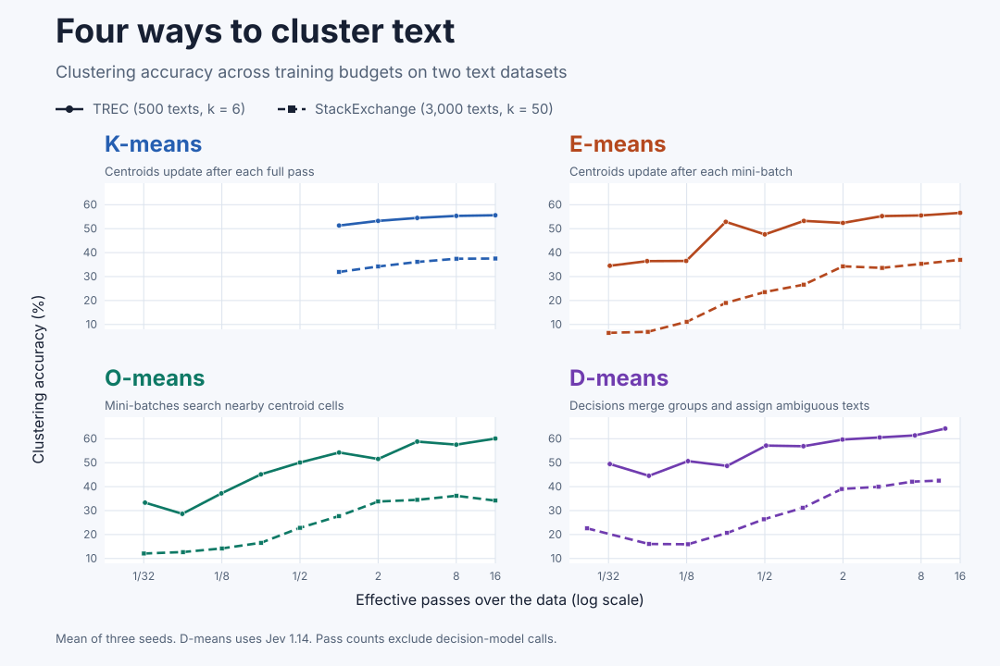
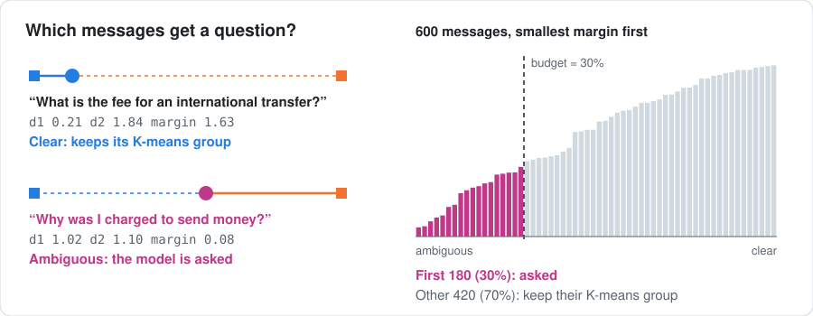
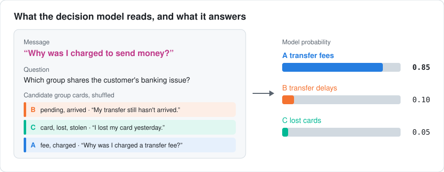
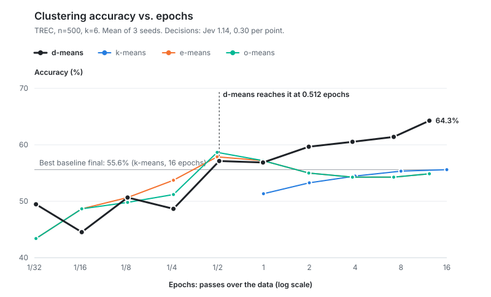

<h1 align="center">
  
</h1>

<p align="center">
  Python 3.10+ · <a href="LICENSE">MIT License</a> ·
  <a href="#quick-start">Quick start</a> ·
  <a href="#how-it-works">How it works</a> ·
  <a href="#benchmark">Benchmark</a> ·
  <a href="#decision-models">Decision models</a>
</p>

**D-means** groups texts by the topics or intents they share. K-means draws the groups; a decision model reads the texts that sit between them and decides where each one belongs.

### Gain on each backbone

Start D-means from any baseline's partition, and it improves that partition by asking a decision model about 30% of the points.

<!-- bench:backbones -->
| Dataset | K-means → D-means | E-means → D-means | O-means → D-means |
|:--|--:|--:|--:|
| TREC | 56.1 → **62.0** (+5.9) | 59.3 → **62.8** (+3.5) | 55.0 → **56.2** (+1.2) |
| StackExchange | 37.6 → **42.0** (+4.3) | 34.1 → **38.6** (+4.4) | 35.5 → **39.8** (+4.4) |
| AG News | 83.8 → **88.1** (+4.3) | 83.8 → **87.7** (+3.8) | 81.9 → **87.4** (+5.4) |
| BBC News | 95.5 → **95.6** (+0.1) | 87.5 → 86.7 (-0.8) | 77.0 → 76.7 (-0.3) |
| 20 Newsgroups | 59.2 → **62.4** (+3.2) | 55.8 → **59.6** (+3.8) | 57.0 → **61.5** (+4.5) |
| Banking77 | 62.8 → **67.9** (+5.1) | 61.7 → **66.5** (+4.8) | 59.8 → **64.0** (+4.2) |
| Mean gain | **+3.8** | **+3.3** | **+3.2** |

ACC (%), mean of seeds 0, 1, 2, Clef, 30% of points asked. Each column starts D-means from that baseline's own partition, so the gain is measured against the partition it starts from. D-means improves its backbone in 16 of 18 cases.
<!-- /bench:backbones -->

On BBC News the E-means and O-means partitions trail K-means by 8 to 18 points, and settling boundary points does not repair them: D-means moves them by −0.8 and −0.3.

<p align="center">
  
</p>

The TREC and StackExchange convergence plot was recorded with Jev 1.14 and the v1 merge strategy (`start="merge"`). Each marker is the mean of three runs, and pass counts exclude Jev calls. See the [convergence analysis](#benchmark) for the replay commands and per-dataset curves.

## How it works

D-means takes **texts, their embedding vectors, and a target number of groups `k`**. The `about` instruction tells the decision model what makes two texts belong together, such as the customer's banking issue.

<p align="center">
  
</p>

### Example: sort 600 banking messages into 3 groups

Suppose the messages cover transfer fees, delayed transfers, and lost cards. Two messages can both mention a *transfer* but describe different issues. Distance alone mixes them up near the boundary, and that is where D-means asks.

```python
from dmeans import DMeans
from dmeans.deciders import Decisions

model = DMeans(k=3, decider=Decisions("cloudflare/clef"), about="customer's banking issue")
labels = model.fit(embeddings, texts)  # 600 vectors and their 600 messages
```

The groups, probabilities, and scores below are illustrative, not benchmark outputs. The algorithm returns numeric labels; names such as "transfer fees" explain the example and are not supplied as categories.

**1. Split by distance.** K-means, best of 10 initializations, splits the vectors into `k = 3` groups. Each group gets a **card**: its most distinctive words and four representative messages.

| Group | Typical words | Example message |
|:--|:--|:--|
| 1 | transfer, fee, charged | "Why was I charged a transfer fee?" |
| 2 | transfer, pending, arrived | "My transfer still hasn't arrived." |
| 3 | card, lost, stolen | "I lost my card yesterday." |

**2. Find the ambiguous messages.** D-means ranks every message by the gap between its two nearest group centres and flags the closest 30%: **180 of these 600 messages**. The other 420 keep their K-means group.

<p align="center">
  <picture>
    <source media="(prefers-color-scheme: dark)" srcset="assets/step-select-dark.svg">
    
  </picture>
</p>

**3. Ask the model.** For each flagged message the model reads the nearest group cards and answers: *which group shares the customer's banking issue of this text?* This multiple-option question is a **Choice** in the API. D-means multiplies the model's probability by a distance weight. For *"Why was I charged to send money?"* distance slightly favours transfer delays:

<p align="center">
  <picture>
    <source media="(prefers-color-scheme: dark)" srcset="assets/step-ask-dark.svg">
    
  </picture>
</p>

| Candidate group | Model probability | Distance weight | Product |
|:--|--:|--:|--:|
| Transfer fees | 0.85 | 0.80 | **0.6800** |
| Transfer delays | 0.10 | 1.00 | 0.1000 |
| Lost cards | 0.05 | 0.05 | 0.0025 |

The largest product wins, so the message moves to **transfer fees**. Both the model's reading and the vector distances shape the final choice. If the provider refuses to answer, every candidate gets the same probability, so distance alone decides and the message keeps its K-means group.

<details><summary>Exact defaults and implementation details</summary>

- **Start (`start="kmeans"`):** scikit-learn `KMeans(k, n_init=restarts)`, `restarts=10`, seeded by `seed`. Cards use class-based TF-IDF keywords and up to four texts nearest the group's mean vector.
- **Point selection:** `budget=0.30`; ask about `round(0.30 × n)` points with the smallest gap between their two nearest centroid distances.
- **Final choice:** `candidates=5`, capped at `k`, in a shuffled order. For each candidate, the distance weight is `exp(−(distance − closest_distance) / tau)`, where `tau` is the median gap across the corpus (or `1e-6` if zero). Multiply this by the model probability (with `1e-6` smoothing) and take the largest score.
- **v1 merge path (`start="merge"`):** over-cluster into `3k` E-means micro-clusters, ask a same-topic **Noul** for each micro-cluster and its six nearest neighbours, merge to `k` by average linkage on `1 − p`, then settle as above. It can repair structure that geometry gets wrong, as the synthetic chart below shows, but real decision models answer these pairwise questions too strictly to merge well on news topics. It stays available, and the convergence charts replay with it.
- **Optional consensus check (`consensus=True`):** compare K-means partitions of the embeddings and a low-rank TF-IDF view by adjusted mutual information; at `1/3` or more, return a joint fit with zero model calls. Excluded from the benchmark.

`model.report` records point decisions and points moved; `model.merge_labels` holds the partition before the model spoke.

</details>

## Quick start

```bash
uv sync
export OPENROUTER_API_KEY=sk-or-...
```

```python
from dmeans import DMeans
from dmeans.deciders import Decisions    # or LLM, or your own function

model = DMeans(k=6, decider=Decisions("cloudflare/clef", cache="answers.jsonl.gz"),
               about="type of answer the question asks for")
labels = model.fit(embeddings, texts)   # embeddings: (n, d) float32, texts: n strings
print(model.report)                     # decisions asked, points moved
```

The E-means and O-means engines work on their own, on any vectors:

```python
from dmeans import EMeans, OMeans

centroids, labels = EMeans(k=1024, nepochs=5).fit(x)
centroids, labels = OMeans(k=8192, nepochs=2).fit(x)   # two-level assignment
```

### Bring your own decision model

D-means is tied to no model, and no model is an import: you name it as a string. `decider` takes any of these:

```python
from dmeans import DMeans
from dmeans.deciders import Decisions, LLM

DMeans(k, decider=Decisions("typesafe/jev-1.14"))             # TypeSafe Jev, OpenRouter Decisions API
DMeans(k, decider=Decisions("cloudflare/clef"))               # Cloudflare Clef, open weights, same API
DMeans(k, decider=Decisions("google/gemini-decision-1"))      # Google Gemini Decision 1
DMeans(k, decider=Decisions("openai/gpt-6-luna-decisions"))    # OpenAI GPT-6 Luna Decisions
DMeans(k, decider=Decisions("liquid/d1.2-ultra"))              # Liquid AI d1.2-ultra
DMeans(k, decider=LLM("openai/gpt-5-mini"))                   # any chat model on OpenRouter
DMeans(k, decider=LLM("qwen3:8b", base_url="http://localhost:11434/v1", api_key_env=None))  # local Ollama
DMeans(k, decider=lambda state, question: ...)                # your own function
```

`LLM` speaks any OpenAI-compatible `/chat/completions` endpoint, caches and replays answers offline exactly like `Decisions`, and re-asks when a reply is unusable. A function gets one typed question at a time and may answer loosely: `True`, `"87%"`, an option name, or unnormalised scores. Every answer is checked and coerced into one shape before D-means uses it, and a missing answer fails with the question it skipped. Anything else with `ask(requests) -> answers` works too; subclass `CachedDecider` to get the cache for free.

### Decision models

Each column runs the default D-means strategy and changes only the decision model it calls. The best baseline is the highest mean among K-means (best of 10 initializations), E-means and O-means.

<!-- bench:models -->
| Dataset | Best baseline | Clef | Gemini Decision 1 | Jev 1.14 | Luna Decisions | d1.2-ultra |
|:--|--:|--:|--:|--:|--:|--:|
| TREC | 59.3 | **62.0** | 60.3 | 60.7 | 58.6 | 61.9 |
| StackExchange | 37.6 | 42.0 | **42.7** | 42.0 | 41.2 † | 42.5 |
| AG News | 83.8 | **88.1** | 87.4 | 85.8 | 84.6 † | 87.8 |
| BBC News | 95.5 | 95.6 | 96.5 | 94.3 | 93.1 † | **96.9** |
| 20 Newsgroups | 59.2 | 62.4 | **64.1** † | 63.2 | 62.6 † | 63.9 |
| Banking77 | 62.8 | 67.9 | 66.9 | 66.8 | 66.6 † | **67.9** |

ACC (%), mean of seeds 0, 1, 2. Datasets where D-means beats the best baseline: Clef 6 of 6, Gemini Decision 1 6 of 6, Jev 1.14 5 of 6, Luna Decisions 4 of 6 and d1.2-ultra 6 of 6.

† The provider refused some requests, which count as neutral answers (equal probabilities): Luna Decisions on StackExchange (148), Luna Decisions on AG News (148), Luna Decisions on BBC News (5), Gemini Decision 1 on 20 Newsgroups (5), Luna Decisions on 20 Newsgroups (43), Luna Decisions on Banking77 (9). A refused point keeps its K-means assignment and stays in the accuracy denominator.
<!-- /bench:models -->

Every column replays offline from its own committed answers: `uv run python -m bench.semantic --model google/gemini-decision-1 --verify`. Per-seed ACC, NMI and ARI are in `bench/results/semantic-<model>.json`. To fill a dash, add `--live --write --no-ablations --datasets trec,stackexchange,ag-news,bbc-news,20-newsgroups,banking77`; answers already paid for come from the cache.

## Benchmark

### Against every baseline

D-means on its default K-means backbone, against the best of K-means, E-means and O-means on each dataset.

<!-- bench:semantic -->
| Dataset | K&#8209;means | E&#8209;means | O&#8209;means | **D&#8209;means** |
|:--|--:|--:|--:|--:|
| TREC | 56.1 | 59.3 | 55.0 | **62.0** |
| StackExchange | 37.6 | 34.1 | 35.5 | **42.0** |
| AG News | 83.8 | 83.8 | 81.9 | **88.1** |
| BBC News | 95.5 | 87.5 | 77.0 | **95.6** |
| 20 Newsgroups | 59.2 | 55.8 | 57.0 | **62.4** |
| Banking77 | 62.8 | 61.7 | 59.8 | **67.9** |

Clustering accuracy (%), mean of seeds 0, 1, 2. D-means uses Clef. D-means beats the best baseline on ACC, NMI and ARI on 6 of 6 datasets. ACC leads on every seed for StackExchange, AG News, 20 Newsgroups and Banking77. Every D-means number comes from Clef answers through OpenRouter (36,801 decisions, committed in [`bench/results/clef-answers.jsonl.gz`](bench/results/clef-answers.jsonl.gz)).

<details><summary>Run details, NMI and ARI</summary>

| Dataset | Texts | Clusters | Lead (pp) | Cost/run |
|:--|--:|--:|--:|--:|
| TREC | 500 | 6 | +2.7 | $0.014 |
| StackExchange | 3,000 | 50 | +4.3 | $0.107 |
| AG News | 7,600 | 4 | +4.3 | $0.436 |
| BBC News | 1,000 | 5 | +0.1 | $0.075 |
| 20 Newsgroups | 7,299 | 20 | +3.2 | $0.567 |
| Banking77 | 3,080 | 77 | +5.1 | $0.081 |

Lead is the accuracy difference from the best baseline, in percentage points.

| Dataset | K-means NMI | E-means NMI | O-means NMI | D-means NMI | K-means ARI | E-means ARI | O-means ARI | D-means ARI |
|:--|--:|--:|--:|--:|--:|--:|--:|--:|
| TREC | 43.5 | 45.2 | 43.1 | **50.2** | 43.6 | 41.1 | 39.4 | **49.5** |
| StackExchange | 48.9 | 45.7 | 46.5 | **53.7** | 23.4 | 18.8 | 20.0 | **28.4** |
| AG News | 60.0 | 60.5 | 58.9 | **68.5** | 62.9 | 62.9 | 60.5 | **71.9** |
| BBC News | 86.6 | 82.3 | 75.3 | **87.3** | 89.3 | 81.4 | 70.0 | **89.5** |
| 20 Newsgroups | 57.4 | 56.7 | 57.4 | **61.2** | 41.8 | 39.5 | 41.1 | **47.0** |
| Banking77 | 81.0 | 81.0 | 80.1 | **84.4** | 53.1 | 52.0 | 49.5 | **59.7** |

</details>
<!-- /bench:semantic -->

K-means takes the best of 10 initializations, the same start D-means uses, so every point of lead comes from the decision model. [See the per-seed results](bench/results/semantic-clef.json).

```bash
uv run python -m bench.semantic --verify   # main table with Clef, offline replay
uv run python -m bench.semantic --model typesafe/jev-1.14 --verify  # any other decision model
uv run python -m bench.semantic --live     # ask Clef again (needs OpenRouter credits)
uv run python -m bench.study --verify     # backbones, budget and random-selection control, offline
uv run python -m bench.mse --write         # engine benchmark, no decision model
uv run python -m bench.convergence --verify # accuracy vs epochs, offline, about 25 s
uv run pytest                              # offline tests
```

Datasets: [TREC](https://huggingface.co/datasets/SetFit/TREC-QC) questions by answer type and [StackExchange](https://huggingface.co/datasets/mteb/stackexchange-clustering) titles by site (3,000 from the first MTEB validation split). [AG News](https://github.com/mhjabreel/CharCnn_Keras/tree/master/data/ag_news_csv) headlines by section, [BBC News](https://huggingface.co/datasets/SetFit/bbc-news) articles by topic, [20 Newsgroups](https://huggingface.co/datasets/SetFit/20_newsgroups) posts by group and [Banking77](https://github.com/PolyAI-LDN/task-specific-datasets) customer requests by intent were also evaluated with Clef. Test splits, texts cut at 1,000 characters. Embeddings: `sentence-transformers/all-mpnet-base-v2`. Baselines: scikit-learn `KMeans` (K-means++, best of 10 initializations, Lloyd to convergence), and the authors' own E-means and O-means code at 5 epochs, all on the same embeddings and seeds. E-means is `faiss.contrib.e_means.NumpyEmeans` from the `faiss-cpu` wheel, run unchanged. O-means is the official [`contrib/o_means`](https://github.com/owlgebra-ai/faiss/tree/main/contrib/o_means), vendored in [`bench/third_party/o_means`](bench/third_party/o_means): its training loop and schedule are untouched, and only its Triton GPU kernels are replaced by torch CPU code with the same arithmetic, checked in `tests/test_official.py`.

**Ablations.** The same Clef runs as the main table, one change at a time. *Merge start* is the v1 strategy.

<!-- bench:ablation -->
| Variant | TREC | StackExchange | AG News | BBC News | 20 Newsgroups | Banking77 | decisions / point |
|:--|--:|--:|--:|--:|--:|--:|--:|
| best baseline | 59.3 | 37.6 | 83.8 | 95.5 | 59.2 | 62.8 | 0 |
| k-means start only (no decisions) | 56.1 | 37.6 | 83.8 | 95.5 | 59.2 | 62.8 | 0 |
| **D-means (default)** | 62.0 | 42.0 | 88.1 | 95.6 | 62.4 | 67.9 | 0.30 |
| point budget 15% | 59.0 | 40.1 | 87.2 | 96.1 | 61.2 | 66.0 | 0.15 |
| decision only (no geometric prior) | 62.1 | 42.1 | 88.4 | 95.4 | 62.1 | 67.9 | 0.30 |
| merge start (v1 strategy) | 66.8 | 42.4 | 70.0 | 70.2 | 47.2 | 63.5 | 0.16 to 0.46 |

ACC (%), mean of the same seeds.
<!-- /bench:ablation -->

**How many points to ask about, and which.** The same K-means backbone, asking about a growing share of points chosen by smallest margin, and a control that asks about 30% chosen at random.

<!-- bench:budget -->
| Points asked | TREC | StackExchange | AG News | BBC News | 20 Newsgroups | Banking77 |
|:--|--:|--:|--:|--:|--:|--:|
| 0% (K-means) | 56.1 | 37.6 | 83.8 | 95.5 | 59.2 | 62.8 |
| 15% by margin | 59.0 | 40.1 | 87.2 | 96.1 | 61.2 | 66.0 |
| **30% by margin (default)** | 62.0 | 42.0 | 88.1 | 95.6 | 62.4 | 67.9 |
| 45% by margin | 62.9 | 43.6 | 88.3 | 95.4 | 62.9 | 69.0 |
| 60% by margin | 64.3 | 44.9 | 88.3 | 95.4 | 63.1 | 69.7 |
| 100% (every point) | 64.7 | 45.5 | 88.3 | 95.4 | 63.1 | 69.9 |
| 30% at random | 57.6 | 40.2 | 85.3 | 95.4 | 60.5 | 64.7 |

ACC (%), mean of the same seeds, Clef, K-means backbone. 100% asks the model about every point.
<!-- /bench:budget -->

On five datasets accuracy rises with every extra point asked and levels off past 60%. On BBC News, where K-means already reaches 95.5%, asking more does not help. On the other five, the default 30% buys 55% to 95% of the gain of asking about every point, at 30% of the calls. Choosing that 30% by margin beats choosing it at random on every dataset, by 0.2 to 4.4 points.

**Why the merge path is no longer the default.** With Clef, the v1 merge path trailed on AG News, BBC News and 20 Newsgroups. Its micro-clusters were pure enough (95% on BBC News), but Clef answered "different topic" to most pairs from the same class, so average linkage merged on noise. Starting from K-means and spending the model's calls on the boundary wins on all six datasets. The merge path still scores higher on TREC (66.8 against 62.0), where answer type cuts across the embedding's topics; pass `start="merge"` when categories do not follow topical similarity.

**Convergence of the v1 merge path.** How many passes over the data each method needs before its clusters match the real categories. Every point is a finished run with that epoch budget. The first chart is synthetic and runs offline: 6 topics, each spread over 4 sub-topic modes placed at random, so neighbouring modes often belong to different topics, with a simulated decider that reads the hidden topic and answers wrong one time in five. The TREC and StackExchange charts are real texts with real Jev answers (40,298 decisions, about $1, committed in [`bench/results/jev-convergence.jsonl.gz`](bench/results/jev-convergence.jsonl.gz)). Where O-means draws over E-means, it scans every cell at that k.

<!-- bench:convergence -->
<picture>
  <source media="(prefers-color-scheme: dark)" srcset="assets/convergence-topics-dark.svg">
  
</picture>

| Method | ACC at 1/32 epoch | ACC at 1 epoch | ACC at 16 epochs | Epochs to reach 41.1% |
|:--|--:|--:|--:|--:|
| K-means | - | 38.3 | 41.1 | 16 |
| E-means | 37.4 | 39.6 | 40.8 | never |
| O-means | 38.3 | 41.2 | 41.1 | 1 |
| **D-means** | **48.0** | **49.8** | **49.9** | **0.0213** |

Synthetic topics, mean of 50 seeds, decisions from a simulated decider, wrong on 20% of answers. The best baseline ends at 41.1% (K-means, 16 epochs). D-means passes it at its first budget, 0.0213 epochs, 47x sooner than the fastest baseline gets there (O-means, 1 epochs).

<picture>
  <source media="(prefers-color-scheme: dark)" srcset="assets/convergence-trec-dark.svg">
  
</picture>

| Method | ACC at 1/32 epoch | ACC at 1 epoch | ACC at 16 epochs | Epochs to reach 60.1% |
|:--|--:|--:|--:|--:|
| K-means | - | 51.3 | 55.6 | never |
| E-means | 34.5 | 53.3 | 56.6 | never |
| O-means | 33.3 | 54.3 | 60.1 | 16 |
| **D-means** | **49.5** | **56.9** | **64.3** | **3.84** |

TREC, mean of 3 seeds, decisions from Jev 1.14. The best baseline ends at 60.1% (O-means, 16 epochs). D-means passes it at 3.84 epochs, 4x sooner than the fastest baseline gets there (O-means, 16 epochs).

<picture>
  <source media="(prefers-color-scheme: dark)" srcset="assets/convergence-stackexchange-dark.svg">
  
</picture>

| Method | ACC at 1/32 epoch | ACC at 1 epoch | ACC at 16 epochs | Epochs to reach 37.5% |
|:--|--:|--:|--:|--:|
| K-means | - | **31.9** | 37.5 | 16 |
| E-means | 6.5 | 26.7 | 37.0 | never |
| O-means | 12.1 | 27.7 | 34.2 | never |
| **D-means** | **22.6** | 31.2 | **42.5** | **1.96** |

StackExchange, mean of 3 seeds, decisions from Jev 1.14. The best baseline ends at 37.5% (K-means, 16 epochs). D-means passes it at 1.96 epochs, 8x sooner than the fastest baseline gets there (K-means, 16 epochs).
<!-- /bench:convergence -->

Geometry converges, but to the wrong partition, and more epochs do not fix it. On the synthetic topics D-means is past the best baseline after one mini-batch. On real texts D-means also gets there first: at 1.96 epochs on StackExchange (k=50), where E-means and O-means never reach the target, and at 3.84 epochs on TREC (k=6), where only O-means reaches it, at 16 epochs. D-means ends 4.2 points (TREC) and 5.0 points (StackExchange) above the best baseline. `bench.convergence --problems trec,stackexchange --seeds 0,1,2 --verify` replays the real curves offline.

**Engines.** D-means' own NumPy E-means and O-means (`dmeans.EMeans`, `dmeans.OMeans`, used inside D-means and on bare vectors, not as benchmark baselines) reproduce what their authors report: E-means passes Lloyd's 25-iteration error within a few epochs, and O-means reaches it with a fraction of the distance computations.

<!-- bench:mse -->
| Problem | Epochs | E-means MSE vs Lloyd@25 | O-means MSE vs Lloyd@25 | O-means distances vs E-means | Lloyd@25 time | E-means time | O-means time |
|:--|--:|--:|--:|--:|--:|--:|--:|
| synthetic (n=100k, d=32, k=8192) | 1 | +4.93% | +4.94% | 0.26x | 111.2s | 3.1s | 1.2s |
| synthetic (n=100k, d=32, k=8192) | 2 | -0.96% | -0.47% | 0.26x | 111.2s | 4.3s | 3.0s |
| synthetic (n=100k, d=32, k=8192) | 3 | -1.56% | -1.00% | 0.26x | 111.2s | 5.6s | 4.8s |
| synthetic (n=100k, d=32, k=8192) | 5 | -2.52% | -1.97% | 0.26x | 111.2s | 14.8s | 4.9s |
| text embeddings (n=20k, d=768, k=512) | 1 | +2.28% | +1.30% | 0.75x | 7.4s | 0.4s | 0.9s |
| text embeddings (n=20k, d=768, k=512) | 2 | -0.32% | -0.19% | 0.77x | 7.4s | 0.7s | 1.0s |
| text embeddings (n=20k, d=768, k=512) | 3 | -0.59% | -0.91% | 0.79x | 7.4s | 0.9s | 1.2s |
| text embeddings (n=20k, d=768, k=512) | 5 | -1.06% | -0.98% | 0.80x | 7.4s | 1.4s | 1.1s |
<!-- /bench:mse -->

Held-out MSE, seed 1. Wall times come from a shared, heavily loaded 18-core M5 Max, so read them as rough.

## Fine print

- D-means takes one input the baselines cannot: `about`, a few words that name the grouping ("news topic", "customer request"). Distance has no way to know you mean answer type rather than subject. No label names go in.
- It needs something the decision model can read for each point. On bare vectors use `EMeans` or `OMeans`.
- It optimizes agreement with human categories, not squared error. By default it adds model calls for 30% of the points on top of K-means, so end-to-end cost is the model's, not the engine's.
- The default path keeps K-means' structure and fixes its boundaries. If geometry splits one category across distant modes, only the v1 merge path (`start="merge"`) can rejoin it.
- Replay rebuilds the exact requests, so it needs the embeddings in `.cache/emb`. A fresh clone re-embeds through OpenRouter on the first run.

## Background: E-means and O-means

- **E-means** (Bessa et al., Meta FAIR, [arXiv:2611.09501](https://arxiv.org/abs/2611.09501)): mini-batch K-means with exponential-moving-average centroids, a cosine step schedule, scaling laws that set batch size and step from `(n, k, T)`, dead-cluster revival by splitting a donor, and a last-pass mean. It beats Lloyd's 25-epoch loss in 1.4 to 2.6 epochs, 10 to 45x faster on GPU. Section 3.4 adds approximate (IVF) assignment, where each point is compared only with nearby centroids: 4.3x cheaper at 1B points and 34x at 10B.
- **O-means** ([faiss contrib](https://github.com/owlgebra-ai/faiss/tree/main/contrib/o_means)): E-means with a two-level assignment. Centroids are grouped into cells and each row scans only its `nprobe` nearest cells. The idea is the IVF assignment of E-means Section 3.4, so credit for it belongs to the E-means paper. O-means reports reaching E-means' error 4.49x faster (geometric mean, one RTX 5090).

Both are faster solvers for the same objective. D-means changes what gets decided.

## License

MIT.
